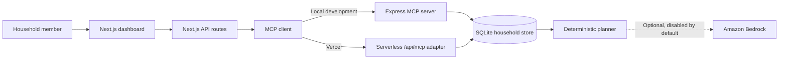
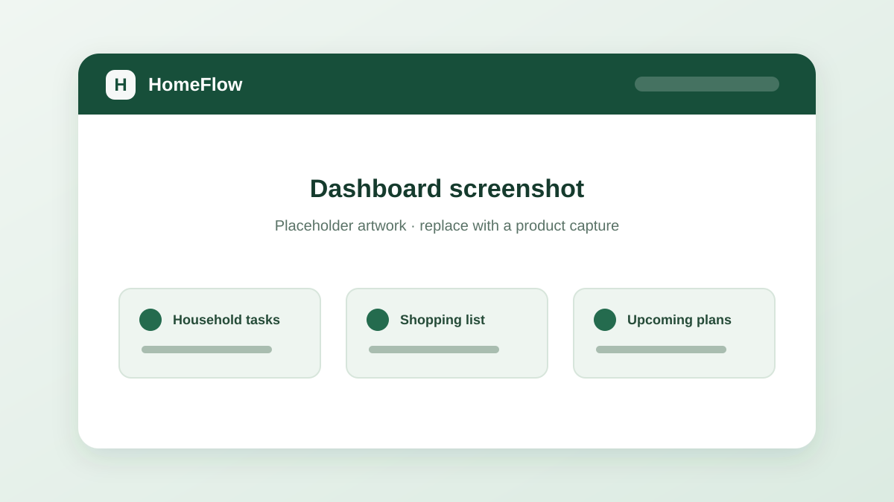
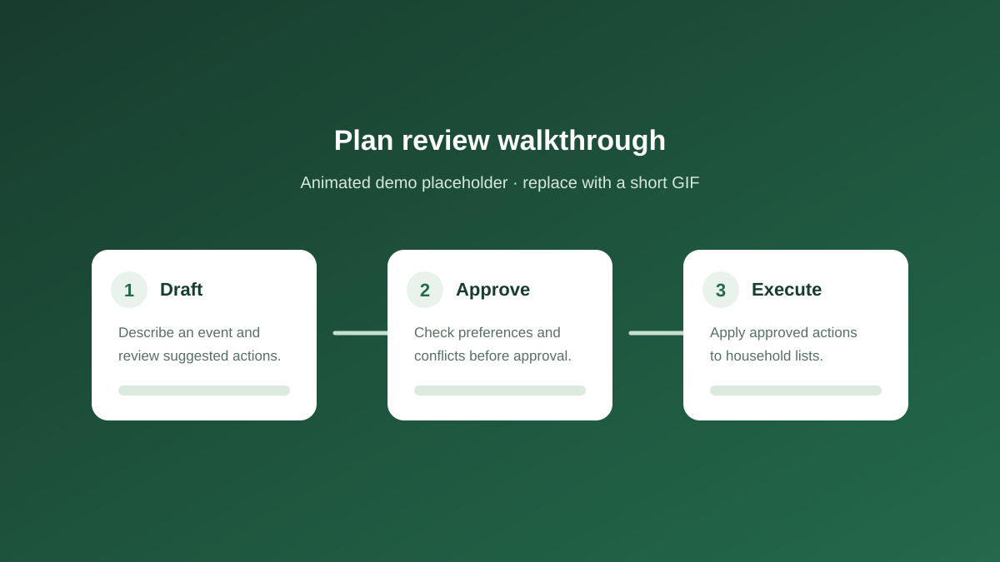

<div align="center">

# HomeFlow

### Household coordination, from a conversation to an approved plan.

Turn everyday requests into shared tasks, shopping lists, reminders, and event plans. Review proposed plans before execution, with household data and actions exposed through the Model Context Protocol (MCP).

[](https://homeflow-taupe-theta.vercel.app)
[](https://github.com/vanshdixit1/HomeFlow/actions/workflows/ci.yml)
[](LICENSE)
[](https://nodejs.org/)

[Launch the live demo](https://homeflow-taupe-theta.vercel.app) · [Report a bug](https://github.com/vanshdixit1/HomeFlow/issues) · [Contribute](CONTRIBUTING.md)

</div>

---

## Overview

HomeFlow is a single-household coordination demo built for the Alexa+ hackathon. A natural-language interface connects a Next.js dashboard to household data and MCP tools. Event plans are drafted with context, preferences, and conflict checks; a person must approve a plan before its actions are applied.

The application runs locally with SQLite and deterministic planning. Bedrock is optional and disabled by default. The hosted demo uses ephemeral SQLite under Vercel `/tmp`; data can reset and is not shared reliably across serverless instances. HomeFlow is not a durable or multi-tenant service.

## Features

- **Conversational workflows:** create household tasks, add shopping items, schedule reminders, and request event plans.
- **Reviewable event plans:** inspect proposed actions and conflicts; approve, execute, or cancel a plan.
- **Household context:** use member preferences, dietary restrictions, inventory, tasks, and events to shape plans.
- **Task and list management:** update or complete tasks, detect duplicates, and remove specific shopping items.
- **MCP tools:** use the same household capabilities through Streamable HTTP.
- **Simple local setup:** SQLite and deterministic planning work without cloud credentials.
- **Production access control:** a shared household password and signed session protect the hosted dashboard; MCP requests use bearer authentication.

## Architecture



## Tech stack

| Area | Technology |
| --- | --- |
| Web application | Next.js 16, React 19, TypeScript |
| API and MCP | Next.js Route Handlers, Express 5, MCP TypeScript SDK, Streamable HTTP |
| Data | SQLite via Node’s built-in SQLite API |
| Validation | Zod 4 |
| Optional AI | Amazon Bedrock Runtime; disabled by default |
| Runtime and package manager | Node.js 24+, npm |
| Hosting | Vercel demo; local self-hosting supported |

## Demo

<div align="center">

[](https://homeflow-taupe-theta.vercel.app)

**[Launch HomeFlow](https://homeflow-taupe-theta.vercel.app)** · [Source code](https://github.com/vanshdixit1/HomeFlow)

</div>

The hosted demo uses one shared household password; it has no username or individual accounts. Local development bypasses the production login. If you do not have the hosted password, the project owner can rotate `HOMEFLOW_ACCESS_PASSWORD` in Vercel and redeploy. Saved Vercel values are encrypted and cannot be retrieved from the CLI.

> **Demo data is temporary.** Vercel stores SQLite in ephemeral, instance-local `/tmp`. State may reset between serverless invocations. Do not use the demo for important household records.

## Screenshots

Replace these illustrative placeholders with captured product images when available.

| Dashboard | Planning and approval walkthrough |
| --- | --- |
|  |  |

## Installation

Requirements: Node.js 24 or newer and npm.

```bash
git clone https://github.com/vanshdixit1/HomeFlow.git
cd HomeFlow
npm ci
```

No AWS account or credentials are required for local development. The default database is created at `data/homeflow.sqlite`.

## Local development

```bash
npm run dev
```

This starts the dashboard at [http://localhost:3000](http://localhost:3000) and the local MCP server at [http://127.0.0.1:3001/mcp](http://127.0.0.1:3001/mcp). The local dashboard opens without the production password gate.

To check MCP after startup, use a second terminal:

```bash
npm run mcp:smoke
```

Optional settings can be supplied through the shell before starting the app. For example, in PowerShell:

```powershell
$env:HOMEFLOW_BEDROCK_ENABLED = 'false'
$env:HOMEFLOW_DB = 'C:\path\to\homeflow.sqlite'
npm run dev
```

## Environment variables

Local defaults are sufficient for the demo. Configure production secrets in the hosting provider’s encrypted environment settings; never commit them.

| Variable | Required | Purpose |
| --- | --- | --- |
| `HOMEFLOW_ACCESS_PASSWORD` | Production | Shared dashboard password; use at least 16 characters. |
| `HOMEFLOW_SESSION_SECRET` | Production | Random signing secret for sessions; use at least 32 characters. |
| `MCP_AUTH_TOKEN` | Production | Bearer token required by the MCP endpoint. |
| `HOMEFLOW_BEDROCK_ENABLED` | No | Defaults to `false`; set to `true` only when Bedrock is intentionally configured. AWS usage may incur charges. |
| `MCP_URL` | No | MCP endpoint override. Local default is `http://127.0.0.1:3001/mcp`; omit on Vercel to use the same deployment’s `/api/mcp`. |
| `MCP_HOST` / `MCP_PORT` | No | Local MCP bind address and port; defaults are `127.0.0.1` and `3001`. |
| `HOMEFLOW_DB` | No | SQLite file path; defaults to `data/homeflow.sqlite` locally and `/tmp` on Vercel. |
| `AWS_REGION` / `BEDROCK_MODEL_ID` | Bedrock only | Region and model for optional Bedrock intent extraction. |

Generate a random session secret locally without sending it to a service:

```bash
node -e "process.stdout.write(require('node:crypto').randomBytes(32).toString('base64url') + '\n')"
```

## Deployment

The live demo is deployed on Vercel. To deploy your own instance:

1. Import the repository into Vercel or link it with the Vercel CLI.
2. Configure `HOMEFLOW_ACCESS_PASSWORD`, `HOMEFLOW_SESSION_SECRET`, `MCP_AUTH_TOKEN`, and `HOMEFLOW_BEDROCK_ENABLED=false` as encrypted project environment variables.
3. Leave `MCP_URL` unset so the web app calls the deployment’s `/api/mcp` endpoint.
4. Deploy with the Vercel dashboard or `vercel --prod`.

Vercel’s filesystem is not durable or shared between function instances. For persistent use, replace the SQLite storage with a managed database and add tenant isolation, migrations, backups, and shared rate limiting. Local self-hosting can use a persistent SQLite file behind HTTPS and a correctly configured trusted reverse proxy.

## MCP architecture

The local Express server in `server/index.ts` registers the household tools and exposes Streamable HTTP at `/mcp`. The web application’s MCP client uses that service locally. On Vercel, the Web-standard adapter in `app/api/mcp/route.ts` exposes the same tools at `/api/mcp` without a long-running server.

MCP calls cover household context, task and shopping updates, reminders, events, preferences, and the plan lifecycle. Plan execution requires a valid, time-bound approval token for the exact plan version. The hosted endpoint requires `Authorization: Bearer <MCP_AUTH_TOKEN>`.

## API overview

| Method | Route | Purpose |
| --- | --- | --- |
| `GET` | `/api/household` | Read household context; requires a production session. |
| `POST` | `/api/message` | Handle a natural-language request. |
| `POST` | `/api/task/status` | Complete or reopen a task. |
| `POST` | `/api/plan/approve` | Approve a plan version. |
| `POST` | `/api/plan/execute` | Execute an approved plan with its token. |
| `POST` | `/api/plan/cancel` | Cancel a plan. |
| `POST` | `/api/plan/reset` | Reset local demo data; disabled in production. |
| `POST` | `/api/auth/login` | Create a production session. |
| `POST` | `/api/auth/logout` | End the current session. |
| `GET`, `POST`, `DELETE` | `/api/mcp` | Serverless MCP Streamable HTTP endpoint. |

## Project structure

```text
app/                 Next.js dashboard and API routes
  api/               Authentication, household, plans, tasks, messages, MCP
lib/                 Store, planner, auth, types, MCP client, optional Bedrock
server/              Local Express MCP server
skills/              Household operations guidance
scripts/             MCP smoke test and deployed E2E verification
tests/               Unit and route tests
docs/screenshots/     README image placeholders
```

## Testing and quality checks

```bash
npm run lint
npm run typecheck
npm test
npm run build
npm run mcp:smoke   # requires the local MCP server from npm run dev
npm audit --audit-level=high
```

The deployment E2E suite can be run against an authorized deployment when `BASE_URL`, `HOMEFLOW_ACCESS_PASSWORD`, and `MCP_AUTH_TOKEN` are available in the process environment or an ignored `.env.local` file:

```powershell
$env:BASE_URL = 'https://your-deployment.vercel.app'
node scripts/test-deployment-e2e.mjs
```

The suite exercises login, household reads, task and shopping flows, plan approval/execution, logout, reset protection, MCP authentication/tools, and the landing page. It changes demo data; use only on a test deployment.

## Security considerations

- Production requires a strong shared password, a random session secret, and an MCP bearer token. Rotate any exposed credential.
- Sessions use secure, HttpOnly cookies. MCP access is authenticated separately.
- Local development bypasses the production session gate; do not expose the development server publicly.
- Login throttling is process-local and is not sufficient for a multi-instance service.
- Trust proxy headers only when the proxy overwrites client-supplied forwarding headers.
- Do not enable Bedrock unless you intend to send requests to AWS and accept possible charges.
- The hosted demo is single-household and ephemeral. Do not enter sensitive personal information or rely on it for durable records.

See [SECURITY.md](SECURITY.md) for responsible vulnerability reporting.

## Roadmap

- Durable database storage, migrations, and backups
- Household accounts, tenant isolation, and shared rate limiting
- Reminder delivery through email, SMS, or push
- Calendar synchronization and member availability
- Shopping integrations and expense tracking
- Voice and smart-home integrations

## Contributing

Contributions are welcome. Start with [CONTRIBUTING.md](CONTRIBUTING.md), run the checks above, and include regression tests for behavior changes. Please keep secrets and household data out of issues and pull requests.

## License

HomeFlow is released under the [MIT License](LICENSE).
